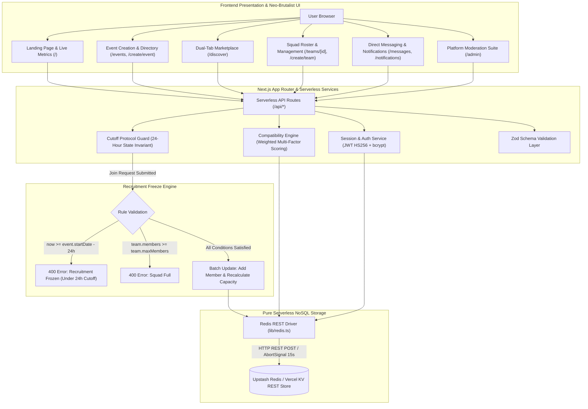

<div align="center">

# TeamSync – Event-Based Team Formation and Matching System

### Last-Minute Event Teammate Matching Platform with 24-Hour Recruitment Cutoff Protocol

<br/>

[](https://team-sync-alpha-ten.vercel.app/)
[](https://upstash.com/)
[](https://nextjs.org/)
[](https://www.typescriptlang.org/)
[](https://tailwindcss.com/)
[](LICENSE)

<br/>

<div align="center">
    <a href="#executive-summary">Executive Summary</a> •
    <a href="#system-architecture">Architecture</a> •
    <a href="#core-features--workflows">Core Features</a> •
    <a href="#24-hour-recruitment-cutoff-protocol">24-Hour Protocol</a> •
    <a href="#weighted-matching-algorithm">Matching Engine</a> •
    <a href="#nosql-database-architecture">Database</a> •
    <a href="#api-reference">API Reference</a> •
    <a href="#benchmark-dataset--demo-accounts">Demo Accounts</a> •
    <a href="#verification--testing">Verification</a> •
    <a href="#quick-start">Quick Start</a>
</div>

</div>

<br/>

---

## Executive Summary

**TeamSync – Event-Based Team Formation and Matching System** is a full-stack, neo-brutalist web application designed for students, collegiate competitors, hackathon organizers, esports teams, and robotics participants. 

In collegiate and competitive environments, finding suitable teammates before registration deadlines is notoriously chaotic: participants are scattered across messaging channels, incomplete squads cannot easily broadcast specific skill gaps, and organizers face last-second team restructuring. TeamSync addresses these problems by providing:
1. **Event Creation & Directory**: Dedicated pages for hosting and browsing hackathons, coding contests, robotics tournaments, and esports championships with reactive countdown timers.
2. **Dual-Tab Marketplace**: Synchronized two-way discovery for teams seeking specific roles and individual participants ("orphans") advertising their skill stacks.
3. **Deterministic Compatibility Scoring**: A multi-factor weighted matching algorithm (0–100%) that pairs candidates with squads based on skill overlap, category, participation mode, and availability.
4. **24-Hour Recruitment Cutoff Protocol**: A strict, server-side enforced deadline invariant that freezes squad rosters exactly 24 hours before kickoff to prevent registration churn.
5. **Pure Serverless Redis NoSQL Persistence**: A zero-config, low-latency key-value data layer with sub-second consistency across Vercel serverless containers, completely free from legacy relational or disk-bound storage dependencies.

---

## System Architecture



---

## Core Features & Workflows

### 1. Event Hosting & Management (`/create/event`, `/events`)
- **Event Creation**: Verified users can publish new events specifying category (*Hackathon*, *Robotics*, *Coding Contest*, *Gaming*, *Sports*, *College Fest*, *Debate*, *Design Sprint*), participation mode (*ONLINE*, *OFFLINE*, *HYBRID*), venue/platform, start time, and description.
- **Dynamic Directory**: Search and filter events with live counts of registered teams and active orphan listings.
- **Event Detail & Countdown**: Dedicated `/events/[id]` page with real-time countdown clocks, status banners (*Registration Open*, *Recruitment Frozen*, *Live Now*), and a directory of teams formed for that event.

### 2. Dual-Tab Marketplace (`/discover`)
- **Find Teams Tab**: Filter teams by event, category, required skills, and availability of open slots.
- **Find Builders Tab (Orphan Listings)**: Discover solo candidates advertising their experience, college, portfolio, and target events.

### 3. Team Formation & Roster Management (`/create/team`, `/teams/[id]`)
- **Squad Requirements**: Team leads specify maximum team capacity (e.g., 3 to 5 members), required core skills, preferred secondary skills, and Discord/contact handles.
- **Interactive Roster View**: Visualized team rosters showing leader badges, member tags, and empty slot placeholders ready for new recruits.
- **Application Pitches**: Candidates submit tailored join pitches directly from the team detail page. Team leaders can review candidate profiles and accept or reject applications with one click.

### 4. Direct Messaging & Notifications (`/messages`, `/notifications`)
- **Peer-to-Peer Messaging**: Built-in chat feed allowing candidates and squad leaders to communicate and align before accepting team invitations.
- **Notification Center**: Real-time alerts for incoming join requests, application acceptances, and cutoff deadline warnings.

### 5. Trust & Community Moderation (`/admin`)
- **Reporting System**: Users can submit community reports against fraudulent listings or abusive behavior.
- **Admin Command Center**: Platform moderators can inspect user profiles, toggle account suspensions, review flagged content, and remove offending listings.

---

## 24-Hour Recruitment Cutoff Protocol

The **24-Hour Recruitment Cutoff Protocol** ensures fairness, prevents team poaching, and guarantees that squad rosters are finalized before competition organizers generate brackets or check-in credentials.

### Timeline Lifecycle

```text
[ Event Kickoff - 7 Days ] ──────> [ Event Kickoff - 24 Hours ] ──────> [ Event Kickoff ]
       Status: OPEN                         Status: FROZEN                     Status: ACTIVE
    Recruitment Active                   Recruitment Locked                  Event in Progress
   Applications Allowed                Applications Rejected                 Rosters Finalized
```

### Invariants & Enforcement
1. **Cutoff Timestamp Calculation**:
   $$\text{CutoffTime} = \text{event.startDate} - (24 \times 60 \times 60 \times 1000)\text{ ms}$$
2. **Server-Side Guard (`lib/cutoff.ts`)**:
   Every mutation to `/api/teams/join-request` executes `checkRecruitmentAllowed()`. If the server clock satisfies $\text{now} \ge \text{CutoffTime}$, the request is rejected with `HTTP 400 Bad Request` and message: `"Recruitment has ended for this event (24h cutoff rule)"`.
3. **Client-Side Indicators**:
   Reactive badges (`Recruitment Open` vs. `Recruitment Frozen`) dynamically switch styling and disable application buttons once the window elapses.

---

## Weighted Matching Algorithm

TeamSync includes a deterministic compatibility engine that computes a match score between a candidate and an open team listing on a scale of **0% to 100%**:

$$\text{Score} = \left( w_s \cdot S_{\text{skills}} \right) + \left( w_c \cdot C_{\text{category}} \right) + \left( w_m \cdot M_{\text{mode}} \right) + \left( w_a \cdot A_{\text{avail}} \right) + \left( w_i \cdot I_{\text{interests}} \right)$$

### Factor Weights

| Factor | Weight ($w$) | Description | Evaluation Logic |
| :--- | :---: | :--- | :--- |
| **Skills Overlap** | **40%** | Technical stack alignment | Jaccard index between candidate skills and team required/preferred skills. Required skills are weighted at 2x. |
| **Category Alignment** | **20%** | Domain expertise | Exact match between candidate's historical events and team's event category (e.g. Hackathon vs. Robotics). |
| **Mode & Location** | **15%** | Logistics feasibility | Compatibility between Online/Offline/Hybrid modes and geographical proximity if offline. |
| **Time Availability** | **15%** | Schedule commitment | Assessment of candidate availability status against event competition duration. |
| **Shared Interests** | **10%** | Culture & goals | Intersection of interest tags (e.g. AI Agents, Web3, Podiums, Open Source). |

```typescript
// Algorithm Implementation (lib/matching.ts)
const SKILL_WEIGHT = 0.40;
const CATEGORY_WEIGHT = 0.20;
const MODE_WEIGHT = 0.15;
const AVAILABILITY_WEIGHT = 0.15;
const INTERESTS_WEIGHT = 0.10;

export function calculateCompatibility(user: User, team: Team, event: Event): number {
  const skillScore = calculateSkillScore(user.skills, team.requiredSkills, team.preferredSkills);
  const categoryScore = user.interests.includes(event.category) ? 1.0 : 0.5;
  const modeScore = (event.mode === "ONLINE" || user.location === event.location) ? 1.0 : 0.4;
  const availScore = user.availability === "HIGH" ? 1.0 : 0.6;
  const interestScore = calculateTagOverlap(user.interests, team.tags);

  const total = (
    skillScore * SKILL_WEIGHT +
    categoryScore * CATEGORY_WEIGHT +
    modeScore * MODE_WEIGHT +
    availScore * AVAILABILITY_WEIGHT +
    interestScore * INTERESTS_WEIGHT
  ) * 100;

  return Math.round(Math.min(100, Math.max(0, total)));
}
```

---

## NoSQL Database Architecture

### Elimination of Relational & Disk-Bound Databases
- **Zero Firebase / Firestore**: Completely removed all external Google Firebase SDKs, credentials, service accounts, and dependencies to avoid initialization latencies and third-party lock-in.
- **Zero TinyDB Disk Storage**: Excised local JSON disk files (`/tmp`, `.data/db.json`), which fail on serverless platforms like Vercel where containers have ephemeral read-only filesystems.
- **Unified Redis NoSQL (REST API)**: Leverages Upstash Redis / Vercel KV through standard stateless HTTPS REST calls. This eliminates TCP connection pooling issues, scales automatically with traffic surges, and provides sub-10ms query times globally.

### Redis State Schema (`lib/redis.ts`)
The entire application state is atomically serialized under the primary Redis key `teamsync_nosql_state`:

```typescript
export interface Schema {
  users: User[];                  // User accounts with bcrypt password hashes
  events: Event[];                // Competitions, categories, modes, dates
  teams: Team[];                  // Squad listings, skill requirements, max capacity
  teamMembers: TeamMember[];      // Squad membership associations and roles
  orphanListings: OrphanListing[];// Solo candidates seeking squads
  joinRequests: JoinRequest[];    // Pending, accepted, or rejected team applications
  notifications: Notification[];  // Real-time user alert records
  messages: Message[];            // Direct messaging conversations
  reports: Report[];              // Moderation complaints and status
}
```

### Automatic Environment Variable Resolution
The database client automatically selects the active endpoint across various cloud setups:
```typescript
const REDIS_URL =
  process.env.STORAGE_REST_API_URL ||
  process.env.STORAGE_REDIS_REST_URL ||
  process.env.UPSTASH_REDIS_REST_URL ||
  process.env.KV_REST_API_URL ||
  "https://cuddly-reptile-187540.upstash.io";

const REDIS_TOKEN =
  process.env.STORAGE_REST_API_TOKEN ||
  process.env.STORAGE_REDIS_REST_TOKEN ||
  process.env.UPSTASH_REDIS_REST_TOKEN ||
  process.env.KV_REST_API_TOKEN ||
  "...";
```

---

## Benchmark Dataset & Demo Accounts

The live production instance is pre-seeded with a comprehensive test benchmark to demonstrate real-world load, search, and matching:

| Entity | Quantity | Description |
| :--- | :---: | :--- |
| **Users** | **100** | Realistic student developers across 10 top universities with diverse skill sets and bcrypt authentication. |
| **Events** | **17** | Distributed across 8 categories (Hackathons, Robotics, Coding, Gaming, Sports, Debates, Fests, Design). |
| **Teams** | **30** | Active squads with defined leader accounts, open vacancies, and skill requirements. |
| **Team Members** | **75** | Roster members distributed across the 30 squads. |
| **Orphan Listings** | **20** | Solo builders actively advertising availability on the Discover marketplace. |
| **Join Requests** | **25** | Applications pending leader review and approval. |
| **Notifications** | **25** | System alerts including join requests and status updates. |
| **Direct Messages** | **50** | Inter-member communication threads. |

### Verified Demo Credentials

Test the platform at **[https://team-sync-alpha-ten.vercel.app/login](https://team-sync-alpha-ten.vercel.app/login)**:

| Role / Persona | Username | Password | Notes |
| :--- | :--- | :--- | :--- |
| **Admin & Team Leader** | `aarav_sharma` | `Password123!` | Leader of *Neural Ninjas*, RV College (Admin role) |
| **Squad Leader** | `aditi_verma` | `Password123!` | Leader of *Cyber Sparks*, BMS College |
| **Squad Leader** | `rohan_patel` | `Password123!` | Leader of *Quantum Builders*, PES University |
| **Solo Builder / Orphan** | `ishaan_sharma` | `Password123!` | Listed on Discover marketplace seeking hackathon team |
| **Existing Registered User** | `dhanush1` | *(Preserved)* | User profile preserved from initial platform signup |

---

## API Reference

| Endpoint | Method | Authentication | Description |
| :--- | :---: | :---: | :--- |
| `/api/auth/register` | `POST` | Public | Create new user account with skills, bio, college, and password hash. |
| `/api/auth/login` | `POST` | Public | Authenticate credentials; sets HTTP-only JWT session cookie. |
| `/api/auth/logout` | `POST` | Session | Invalidate current session and clear session cookie. |
| `/api/auth/me` | `GET` | Session | Return authenticated user identity and role. |
| `/api/events` | `GET` | Public | List all events with category, mode, and text search filters. |
| `/api/events` | `POST` | Session | Create a new event listing with start date and location. |
| `/api/events/[id]` | `GET` | Public | Fetch single event details, associated teams, and orphan listings count. |
| `/api/teams` | `GET` | Public | List teams filtered by event ID, skills, or open status. |
| `/api/teams` | `POST` | Session | Create a new squad listing for an event. |
| `/api/teams/[id]` | `GET` | Public | Retrieve team details, full roster, leader info, and vacant slots. |
| `/api/teams/join-request` | `POST` | Session | Submit application pitch to join a squad *(enforces 24h cutoff rule)*. |
| `/api/teams/join-request` | `PATCH` | Leader | Accept or reject a candidate's join application. |
| `/api/orphans` | `GET` | Public | List solo builders looking for squads. |
| `/api/orphans` | `POST` | Session | Create availability profile for specific event or category. |
| `/api/matching` | `GET` | Session | Return ranked teams or candidates sorted by compatibility score. |
| `/api/messages` | `GET` / `POST`| Session | Fetch conversation history or send a direct message. |
| `/api/notifications` | `GET` / `PATCH`| Session | List user notifications or mark them as read. |
| `/api/reports` | `POST` | Session | Submit community report against a user or listing. |
| `/api/admin/users` | `GET` / `PATCH`| Admin | Moderation endpoint to inspect users and toggle suspensions. |
| `/api/admin/teams` | `GET` / `DELETE`| Admin | Moderation endpoint to review and remove inappropriate squads. |
| `/api/seed` | `GET` / `POST`| Internal | Seeds 100 users, 17 events, and 30 teams into the active Redis store. |

---

## Verification & Testing

The live platform was verified through an end-to-end automated **Puppeteer (Chrome)** test suite against the production deployment at `https://team-sync-alpha-ten.vercel.app`:

```bash
=== STARTING LIVE PRODUCTION VERIFICATION WITH PUPPETEER ===
Target: https://team-sync-alpha-ten.vercel.app

[1/8] Verifying Home Page...
- Home page loaded: "TeamSync – Event-Based Team Formation and Matching System"
  Saved: live_01_homepage.png

[2/8] Verifying Events Directory (17 Events)...
- Detected 17 event card links on /events
  Saved: live_02_events_directory.png

[3/8] Verifying Event Detail Page (eve_1000)...
- Event Detail Heading: "CODEVERSE 2026 NATIONAL HACKATHON"
  Saved: live_03_event_detail.png

[4/8] Verifying Teams Directory (30 Teams)...
- Detected 30 team card links on /teams
  Saved: live_04_teams_directory.png

[5/8] Verifying Discover Marketplace Dual-Tab UI...
  Saved: live_05_discover_marketplace.png

[6/8] Testing Login Flow with Seeded User (aarav_sharma)...
- Submitted credentials, awaiting authentication...
- Current URL: https://team-sync-alpha-ten.vercel.app/dashboard
  Saved: live_06_dashboard_authenticated.png

[7/8] Verifying User Profile (/profile/aarav_sharma)...
- Profile Name: "Profile"
  Saved: live_07_user_profile.png

[8/8] Verifying Direct Messages UI (/messages)...
- Messages thread interaction elements: 9
  Saved: live_08_messages_chat.png

🎉 ALL LIVE PRODUCTION VERIFICATIONS COMPLETED SUCCESSFULLY!
```

---

## Project Structure

```text
TeamSync/
├── app/
│   ├── (auth)/
│   │   ├── login/page.tsx               # Authentication login with brutal styling
│   │   └── register/page.tsx            # Multi-step signup with skill chips
│   ├── admin/page.tsx                   # Protected moderation dashboard
│   ├── api/
│   │   ├── admin/                       # Moderation REST endpoints
│   │   ├── auth/                        # Register, login, logout, me
│   │   ├── events/                      # Events CRUD and filtering
│   │   ├── matching/                    # Compatibility calculation
│   │   ├── messages/                    # Direct messaging
│   │   ├── notifications/               # Real-time alert notifications
│   │   ├── orphans/                     # Builder availability listings
│   │   ├── reports/                     # Abuse & fraud reporting
│   │   ├── seed/                        # Benchmark seeding endpoint
│   │   └── teams/                       # Squad formation and join requests
│   ├── create/
│   │   ├── event/page.tsx               # Host / publish a new event
│   │   ├── orphan/page.tsx              # Post individual builder availability
│   │   └── team/page.tsx                # Create squad and post vacancy
│   ├── dashboard/page.tsx               # User command center and match feed
│   ├── discover/page.tsx                # Dual-tab marketplace (Teams & Builders)
│   ├── events/
│   │   ├── [id]/page.tsx                # Event countdown, mode, and teams roster
│   │   └── page.tsx                     # Searchable events catalog (17 events)
│   ├── messages/page.tsx                # Direct messaging chat interface
│   ├── notifications/page.tsx           # In-app notifications feed
│   ├── profile/[username]/page.tsx      # Builder public profile and portfolio
│   ├── teams/
│   │   ├── [id]/page.tsx                # Squad roster, open slots, leader tools
│   │   └── page.tsx                     # Searchable teams catalog (30 teams)
│   ├── globals.css                      # Neo-brutalist theme design tokens
│   └── layout.tsx                       # Root layout, fonts, navigation, footer
├── components/
│   ├── cards/                           # TeamCard, OrphanCard, EventCard
│   ├── modals/                          # JoinRequestModal, ReportModal, MessageModal
│   ├── navbar/                          # Sticky brutalist navbar with live counters
│   └── ui/                              # BrutalButton, BrutalCard, BrutalInput, Countdown
├── lib/
│   ├── auth.ts                          # JWT signing, cookie verification, bcrypt
│   ├── cutoff.ts                        # 24-hour protocol validation logic
│   ├── db.ts                            # Unified database export
│   ├── matching.ts                      # Compatibility scoring engine
│   ├── redis.ts                         # Pure Redis NoSQL REST client
│   ├── utils.ts                         # Tailwind merge and styling utilities
│   └── validation.ts                    # Zod validation schemas
├── package.json
└── README.md
```

---

## Quick Start

### 1. Prerequisites
- **Node.js**: v18.17.0 or higher
- **Package Manager**: npm, pnpm, or yarn

### 2. Local Setup
```bash
# Clone repository
git clone https://github.com/pprbkt/TeamOrphan.git
cd TeamOrphan

# Install dependencies
npm install
```

### 3. Environment Variables
Create a `.env` file in the project root:
```env
# Authentication & Environment
JWT_SECRET="super_secret_jwt_key_replace_in_production"
NODE_ENV="development"
NEXT_PUBLIC_APP_URL="http://localhost:3000"

# Redis NoSQL REST Configuration (Optional: defaults to cloud instance)
KV_REST_API_URL="https://cuddly-reptile-187540.upstash.io"
KV_REST_API_TOKEN="your_upstash_redis_rest_token"
```

### 4. Running Locally
```bash
# Start Next.js development server
npm run dev

# Open in browser: http://localhost:3000
```

### 5. Production Build
```bash
# Build optimized production bundle
npm run build

# Start local production server
npm run start
```

---

## Technology Stack

| Layer | Technology | Purpose |
| :--- | :--- | :--- |
| **Framework** | Next.js 14.2 (App Router) | Server-side rendering, React Server Components, serverless API routes |
| **Language** | TypeScript 5.6 | Strict static type safety across schemas, state, and API contracts |
| **Database** | Redis NoSQL (Upstash REST / Vercel KV) | Serverless key-value persistence with atomic operations and zero socket overhead |
| **Styling** | Tailwind CSS 3.4 | Custom neo-brutalist design system (high-contrast borders, hard shadows, vibrant accents) |
| **Authentication** | Jose (JWT HS256) + bcryptjs | Stateless, tamper-proof session tokens stored in HTTP-only security cookies |
| **Validation** | Zod 3.23 | Strict runtime payload validation for requests, forms, and entities |
| **Icons** | Lucide React | Clean, scalable interface icons |
| **Date Handling** | date-fns | Date formatting, countdown time math, and interval comparisons |
| **Testing** | Puppeteer Core | Headless Chrome browser automation and UI interaction validation |

---

## License

This project is open-source software licensed under the [MIT License](LICENSE).
